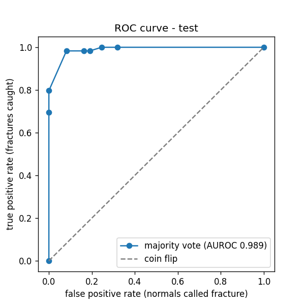
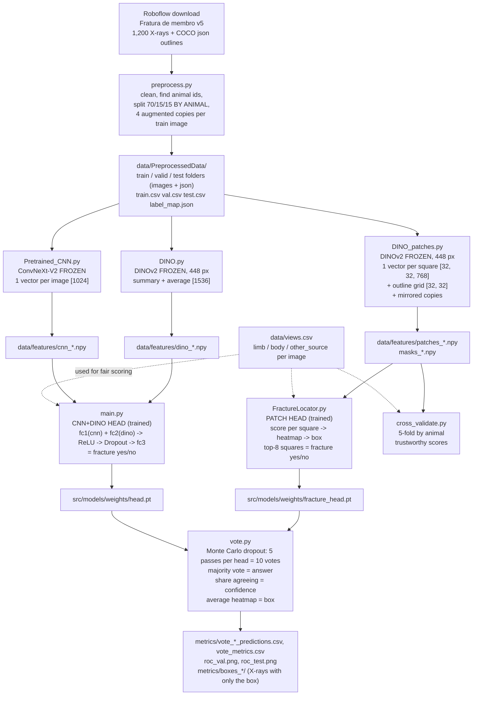

# X-ray ML: the fracture detector behind Radiant

Private ML code for **Radiant**, a web app that looks at dog and cat X-rays and flags problems.
This README explains **every part of the pipeline**, from raw images to the final answer, in plain language.
If a word is new, check the [Glossary](#13-glossary) at the bottom.

---

## Project layout

```
X-ray-ml/
├── README.md
├── src/
│   ├── preprocess/      preprocess.py, augmentation.py (clean + split the X-rays)
│   │                    Pretrained_CNN.py, DINO_patches.py (frozen backbones -> saved features)
│   ├── models/          DINO.py (frozen DINOv2 -> saved features), main.py (CNN+DINO head), FractureLocator.py (patch head + box), vote.py,
│   │   │                cross_validate.py, Xray_Or_Not.py + gate_extra.py + gate_challenge.py (X-ray gate),
│   │   │                export_gate_onnx.py
│   │   └── weights/     head.pt, fracture_head.pt, gate_head.pt, thresholds.json (trained models)
│   └── website/         export_onnx.py, web_model/ (radiant.js, index.html, .onnx models: runs in the browser)
├── data/                raw/, PreprocessedData/, features/, views.csv, gate photos, crops, web pictures, human_data/
├── metrics/             every result: csv scores and predictions, roc_*.png, heatmaps_*/, boxes_*/, gate_challenge/
└── docs/                API_GUIDE.md, WEB_GUIDE.md, HOW_THE_BOX_WORKS.md
```

Every script starts with commented lines that **go to the project folder first**, so all paths
(`data/...`, `src/models/weights/...`, `metrics/...`) work whether you press Run in PyCharm or use a terminal.

---

## Contents

1. [Summary](#1-summary)
2. [Results at a glance](#2-results-at-a-glance)
3. [The pipeline (graph)](#3-the-pipeline-graph)
4. [How to run everything](#4-how-to-run-everything)
5. [The big ideas, explained simply](#5-the-big-ideas-explained-simply)
6. [The data and its problems](#6-the-data-and-its-problems)
7. [File by file: data preparation](#7-file-by-file-data-preparation)
8. [File by file: feature extraction](#8-file-by-file-feature-extraction)
9. [File by file: the two heads](#9-file-by-file-the-two-heads)
10. [File by file: scoring and voting](#10-file-by-file-scoring-and-voting)
11. [Every output file](#11-every-output-file)
12. [Limitations and next steps](#12-limitations-and-next-steps)
13. [Glossary](#13-glossary)
14. [Credits and licenses](#14-credits-and-licenses)

---

## 1. Summary

**Goal:** given a dog or cat X-ray, answer **"is there a broken limb bone?"** and **"roughly where?"** (a box),
together with **how sure** the model is.

**Data:** 1,200 veterinary limb X-rays from Roboflow ("Fratura de membro" v5): 400 with a fracture
(each with an outline of where it is) and 800 normal. They come from **143 animals**, mostly from one hospital.

**Approach:** two big pretrained image models are used **frozen** (never trained by us).
They turn every X-ray into numbers ("features"). On top of those numbers we train **two small heads**:

| Head | Input | Answers | File |
|---|---|---|---|
| **CNN+DINO head** | one ConvNeXt vector + one DINOv2 vector per image, **added together** | fracture yes/no | `main.py` |
| **Patch head (FractureLocator)** | one DINOv2 vector for **each of 32 x 32 squares** of the image | fracture yes/no **and where** (box) | `FractureLocator.py` |

At the end, `vote.py` runs **each head 5 times with dropout switched on** (Monte Carlo dropout).
That gives **10 yes/no votes**. The **majority** is the final answer, the share of agreeing votes is the
**confidence**, and the box comes from the patch head.

**Important things we found and fixed:**
- **View bias.** Fracture images are mostly close-ups of a leg, normal images mostly belly/pelvis views.
  A model could "cheat" by recognising the view. We labelled every image's view and score each view separately.
- **Few animals.** Only ~10 animals per view end up in val/test, so single scores are noisy.
  `cross_validate.py` scores every animal once (5-fold, by animal) for trustworthy numbers.
- **Other-source images.** 59 fracture images come from other scanners and are all fractures, another
  shortcut. They are only used for training, never for scoring.

**What it cannot do:** say the fracture *type* (transverse, oblique, ...). The data only has one label, "fracture".

---

## 2. Results at a glance

### The final answer (vote.py: majority of 10 Monte Carlo dropout votes)

| Split | F1 | Accuracy | Recall (fractures caught) | Precision | AUROC | Confidence when right | Confidence when wrong |
|---|---|---|---|---|---|---|---|
| val  | 0.875 | 0.926 | 0.980 | 0.790 | 0.993 | 0.94 | 0.51 |
| test | 0.921 | 0.941 | 0.983 | 0.866 | 0.989 | 0.92 | 0.53 |

The **confidence is meaningful**: when the model is right it is ~92-94% sure, and when it is wrong it is ~50% sure
(a coin flip). So a low confidence is a real warning sign.

### Each head alone vs. the vote, **inside each view** (the honest numbers: no view shortcut possible)

| AUROC | CNN+DINO alone | Patch head alone | Vote of both |
|---|---|---|---|
| val, limb close-ups | 0.866 | 0.991 | 0.974 |
| val, body views | 0.948 | 1.000 | 0.998 |
| test, limb close-ups | 0.997 | 0.951 | 0.998 |
| test, body views | 0.878 | 1.000 | 0.988 |

The two heads make **different** mistakes, so the vote is steadier than either one alone.

### The most trustworthy numbers: cross-validation over all 143 animals (patch head)

| AUROC limb | AUROC body | Hottest square inside the real fracture | Box overlap (IoU) |
|---|---|---|---|
| ~0.91 | ~0.98 | ~85% | ~0.47 |

**Why val/test look better than cross-validation:** val and test only contain ~10 animals per view.
A few lucky animals can push a score to 0.99. Cross-validation scores **every** animal, so believe it more.



---

## 3. The pipeline (graph)



The same thing as a picture of shapes, for **one** X-ray:

```
X-ray (1024 x 1024)
 |
 |-- ConvNeXt-V2 (frozen, 384 px) ----------------------> cnn vector   [1024]  -+
 |-- DINOv2 (frozen, 448 px) --> summary + average -----> dino vector  [1536]  -+--> CNN+DINO head --> 1 vote x 5 passes
 |                                                                              |
 '-- DINOv2 (frozen, 448 px) --> every square ----------> patches [32, 32, 768] --> patch head --> heatmap [32, 32]
                                                                                       |-> top-8 squares --> 1 vote x 5 passes
                                                                                       '-> average heatmap --> box
                                                    10 votes --> majority = answer, share agreeing = confidence
```

---

## 4. How to run everything

All scripts are run from the project folder with PyCharm's Python (the venv of `MNIST_Detector_ON_PC`,
which has the **CUDA** build of PyTorch, so the RTX 4060 is used). In order:

| Step | Command | Time (RTX 4060) | Needs |
|---|---|---|---|
| 1 | `python src/preprocess/preprocess.py` | ~2 min | the Roboflow folder |
| 2 | `python src/preprocess/Pretrained_CNN.py` | ~10 min | step 1 |
| 3 | `python src/models/DINO.py` | ~5 min | step 1 |
| 4 | `python src/preprocess/DINO_patches.py` | ~3 min | step 1 |
| 5 | `python src/models/main.py` | ~1 min | steps 2 + 3 |
| 6 | `python src/models/FractureLocator.py` | ~2 min | step 4 |
| 7 | `python src/models/vote.py` | ~1 min | steps 5 + 6 |
| optional | `python src/models/cross_validate.py` | ~5 min | step 4 |

**Re-running preprocess.py makes a new split.** After it, re-run every later step,
because the features and heads belong to the old split.

---

## 5. The big ideas, explained simply

### 5.1 Frozen backbone + small head
Training a big image model from scratch needs millions of images. We have 1,200. So we borrow two models
that were already trained on millions of normal photos and **freeze** them (their weights never change).
They act like a ready-made "eye": they turn an image into a list of numbers that describe it (a **feature vector**).
We then only train a **small head** that learns one new question from those numbers: "fracture or not?".

```
Backbone (frozen):   ~88 million numbers, trained by Meta / the ConvNeXt authors, never changed
Our heads:           ~1.3 million (CNN+DINO head) and ~0.8 million (patch head), trained on our X-rays
```

Because the backbone never changes, we run it **once** and save its output to `.npy` files.
Training a head then takes seconds instead of hours.

### 5.2 The two backbones
- **ConvNeXt-V2** (`Pretrained_CNN.py`): a modern CNN. Gives one vector of 1024 numbers per image.
- **DINOv2** (`DINO.py`, `DINO_patches.py`): a Vision Transformer. It cuts the image into squares of 14 x 14 pixels.
  For a 448 x 448 image that is 32 x 32 = 1024 squares ("patches"), and it gives **one 768-number vector per square**,
  plus one extra "summary" vector (CLS) for the whole image.
  - `DINO.py` keeps the summary vector + the average of all squares = 768 + 768 = **1536** numbers per image.
  - `DINO_patches.py` keeps **every square**: [32, 32, 768] per image. That is what makes "where" possible.

### 5.3 Sigmoid, BCE loss, logits
A head outputs a raw score (a **logit**), any number from -inf to +inf. **Sigmoid** squashes it to 0-1:

```
sigmoid(-3) = 0.05    sigmoid(0) = 0.5    sigmoid(3) = 0.95
```

**BCEWithLogitsLoss** (binary cross-entropy) measures how wrong that probability is for a yes/no answer.
Example: the truth is "fracture" (1). If the model says 0.95 the loss is small (0.05); if it says 0.05 the loss is big (3.0).
`pos_weight` makes mistakes on the rarer class count more (e.g. 30x for the rare fracture squares).

### 5.4 Threshold, recall, precision, F1, accuracy, AUROC
A probability becomes a yes/no with a **threshold**: fracture if probability >= threshold.

Example with 6 X-rays, threshold 0.5:

| X-ray | Truth | Probability | Predicted |
|---|---|---|---|
| A | fracture | 0.9 | fracture (TP, true positive) |
| B | fracture | 0.6 | fracture (TP) |
| C | fracture | 0.3 | normal (FN, missed fracture) |
| D | normal | 0.7 | fracture (FP, false alarm) |
| E | normal | 0.2 | normal (TN, true negative) |
| F | normal | 0.1 | normal (TN) |

- **Recall** (= sensitivity) = TP / all fractures = 2/3: *how many fractures did we catch?*
- **Specificity** = TN / all normals = 2/3: *how many normals did we leave alone?*
- **Precision** = TP / all "fracture" answers = 2/3: *when we say fracture, how often is it true?*
- **F1** = 2 x precision x recall / (precision + recall): one number that is only high if **both** are high.
- **Accuracy** = right answers / all = 4/6.
- **AUROC**: forget the threshold and ask, *"pick one fracture and one normal at random. How often does the
  fracture get the higher score?"* Here: 7 of the 9 pairs, so AUROC 0.78. 0.5 = coin flip, 1.0 = perfect.
- **ROC curve**: the line you get by trying **every** threshold and plotting recall (fractures caught) against
  the false-alarm rate (normals flagged). The closer it hugs the top-left corner, the better.

**How we pick the threshold:** on the **val** set (never test), we take the highest threshold that still catches
**90%** of the fractures (`TARGET_RECALL = 0.90` in `main.py`). Missing a fracture is worse than a false alarm.

### 5.5 Dropout and Monte Carlo dropout
**Dropout** randomly switches off some neurons (30% in the CNN+DINO head, 20% of channels in the patch head)
while training, so the head can't depend on any single neuron. That reduces overfitting.
Normally dropout is turned **off** when predicting (`model.eval()`).

**Monte Carlo dropout** leaves it **on** when predicting (`model.train()` inside `torch.no_grad()`), and predicts several times.
Each pass switches off different neurons, so each pass gives a slightly different answer:

```
pass 1: 0.91  pass 2: 0.88  pass 3: 0.93  pass 4: 0.90  pass 5: 0.89   -> all agree   -> sure
pass 1: 0.62  pass 2: 0.31  pass 3: 0.55  pass 4: 0.12  pass 5: 0.48   -> disagree    -> unsure
```

### 5.6 Majority vote and confidence
`vote.py` turns every pass into a **vote** using that head's own val threshold:
5 passes CNN+DINO + 5 passes patch head = **10 votes** per X-ray.
- **Answer** = fracture if **at least 5 of 10** vote fracture (a 5-5 tie counts as fracture, to miss fewer fractures).
- **Confidence** = share of votes that agree with the answer. 10/10 = 100%, 6/10 = 60%, 5/10 = 50% (a coin flip).

### 5.7 Data leakage and splitting by animal
One animal often has many X-rays (different angles, the same day). If one of them is in train and another in test,
the model can **recognise the animal** instead of the fracture, and test scores look too good.
So we split by **animal**: all X-rays of one animal go to the same split.

### 5.8 Shortcuts (why we score per view)
A model takes the easiest path. If "close-up of a leg" usually means fracture and "belly" usually means normal,
it learns *that* instead of what a break looks like, and then calls every healthy leg broken.
We checked: using only brightness and file size, a tiny model already gets **AUROC 0.81** without looking at bones.
So we score **inside each view** (limb close-ups vs body views). There, "which view is it" can't help.

### 5.9 Cross-validation
Instead of one train/val/test split, split the **animals** into 5 groups. Train on 4 and score the 5th,
5 times, so every animal is scored once by a model that never saw it. Much less luck than one small test set.

---

## 6. The data and its problems

**Source:** [Roboflow "Fratura de membro" v5](https://universe.roboflow.com/rodrigodoutorado/fratura-de-membro/dataset/5)
("Dataset Final (400 Frat e 800 N-Frat)"), CC BY 4.0. COCO format: one `_annotations.coco.json` per folder,
images stretched to 1024 x 1024. An image **with** an outline = fracture, **without** = normal.

**Animals:** the original file name holds the animal id: `DX000098_4.jpg` -> animal `DX000098`, 4th X-ray.
143 animals, ~8 X-rays each. 142 of the 143 are all-fracture or all-normal.

**Views** (`data/views.csv`): we grouped all images by how they look (DINO features + KMeans, 24 groups)
and checked every group by eye:

| View | Fracture | Normal |
|---|---|---|
| limb (close-up of a leg) | 245 | 156 |
| body (belly / pelvis / side view, hind legs visible) | 96 | 644 |
| other_source (CR / img / RAYSSINHA: other scanners) | 59 | 0 |

**Privacy:** the X-rays have burned-in text (pet name, hospital name). That is why `metrics/` pictures and `data/` are in `.gitignore`.

---

## 7. File by file: data preparation

### `preprocess.py`: raw download -> clean, split dataset
**In:** the Roboflow folder (`INPUT`). **Out:** `data/PreprocessedData/`.

| Setting | Value | Meaning |
|---|---|---|
| `INPUT` | Roboflow folder | a CSV, label folders, or a COCO export all work |
| `OUTPUT` | `data/PreprocessedData` | where everything is written |
| `VAL_SIZE`, `TEST_SIZE` | 0.15, 0.15 | train gets the other 70% |
| `AUGMENT_COPIES` | 4 | extra augmented copies of every train image |
| `MIN_SIZE`, `MAX_SIZE` | 64, 1024 | too small = rejected; too big = shrunk |
| `TRAIN_ONLY` | CR, img, RAYSSINHA | other-source animals only go to train |

Step by step:
1. **Load.** For COCO: read each folder's json; an image with outlines = `fracture`, else `normal`.
   The animal id is the original name without `_N` (`re.sub(r"_\d+$", "", name)`).
   The fracture outlines are kept in `coco_anns` for step 12.
2. **Drop empty** paths/labels.
3. **One row per image.** If an image appears twice with different findings they are joined: `"fracture|tumor"`.
4. **Check every image:** opens it (broken files fail), measures its smallest side, and computes an **md5 hash**
   (a fingerprint of the file content: same content -> same hash).
5. **Duplicates:** same hash = same image. Keep one. If copies have **different** labels, drop all of them.
6. **Too small** (< 64 px) -> rejected.
7. **Too big** (> 1024 px) -> shrunk, keeping the shape.
8. **Label numbers:** `label_map.json` = `{"fracture": 0, "normal": 1}` (alphabetical). `label_ids` = `"0"` or `"1"`.
9. **Split by animal.** Other-source animals go to train. The rest are grouped by their findings and each group
   is shuffled and cut 70/15/15. An animal's X-rays all go to the same split.
10. **Copy** the kept images into `data/PreprocessedData/train`, `valid`, `test`.
11. **Augment train only:** 4 copies of each train image via `augment()` (small flip/rotate/shift/brightness/blur).
    Val and test stay real X-rays.
12. **Write COCO json** per folder. Every image gets `label`, `animal`, `augmented`. Real images keep their outlines.
    Augmented copies get **none** (the outline no longer fits after rotating).
13. **Save** `train.csv`, `val.csv`, `test.csv`, `rejected.csv`, `label_map.json`.

Result: train 842 real images (+ 4 x 842 augmented = 4,210 rows), val 189, test 169.

### `augmentation.py`
`augment()` is the recipe `preprocess.py` uses: random horizontal flip, rotate up to 10 degrees, shift/zoom up to 5%,
brightness/contrast +-20%, and sometimes a light blur. All mild, so bones stay realistic.
It also has `train_transforms()`, `eval_transforms()` and `XrayDataset` for training on images directly (not used by the current pipeline).

---

## 8. File by file: feature extraction

### `Pretrained_CNN.py`: one ConvNeXt vector per image
- Loads `convnextv2_base.fcmae_ft_in22k_in1k_384` from **timm** with `num_classes=0` (classifier removed),
  so it outputs the 1024-number feature vector instead of ImageNet classes.
- Frozen: `model.eval()` and `requires_grad = False`. Runs on the GPU.
- `transforms` = the model's own resize (384 px) + normalisation.
- For every row of `train/val/test.csv`: open -> RGB (gray copied into 3 channels) -> model -> [1, 1024].
- **Out:** `data/features/cnn_{split}.npy`, shape [N, 1024]. Row i = row i of the csv.

### `DINO.py` (in `src/models/`): one DINOv2 vector per image
- Loads `facebook/dinov2-base` from **transformers**, frozen.
- `SIZE = 448` (must be a multiple of 14) and **no centre crop**, so a fracture near the edge isn't cut off.
- `last_hidden_state` has shape [1, 1 + 1024, 768]: 1 summary token + 1024 square tokens.
- Keeps `cls = tokens[:, 0]` (summary) and `patches = tokens[:, 1:].mean(dim=1)` (average of all squares)
  -> joined = [1, 1536].
- **Out:** `data/features/dino_{split}.npy`, shape [N, 1536].

**`DINO.py` vs the old `OnlyDino.py`** (deleted): two different kinds of file.
- `DINO.py` = **feature extraction**. Runs the frozen DINOv2 on every X-ray and saves 1536 numbers per image.
  No training: DINO's weights never change (`.eval()`, `torch.no_grad()`, no optimizer).
- `OnlyDino.py` was **training**: a small head trained on those DINO numbers **alone, without the CNN numbers**,
  an experiment to check whether ConvNeXt is needed. Nothing used it, so it was deleted.

```
DINO.py:      X-ray -> DINOv2 (frozen) -> dino_*.npy                          (makes the features)
main.py:      cnn_*.npy + dino_*.npy -> trained head -> fracture yes/no        (the one we use)
OnlyDino.py:  dino_*.npy only        -> trained head -> fracture yes/no        (experiment, deleted)
```

### `DINO_patches.py`: one DINOv2 vector per **square** + the outline grid
Like `DINO.py`, but keeps **every** square instead of averaging, so a head can learn **where**.
- `read_outlines()` reads the COCO json -> `{file name: [outline, ...]}`, each outline a list of (x, y) points
  (COCO stores them flat: `[x1, y1, x2, y2, ...]`).
- `make_mask()` draws the outlines white on a black image the size of the X-ray.
- `mask_to_grid()` shrinks that mask to 32 x 32 with `Image.BOX` (averaging), so every square becomes
  *how much of it is fracture*: 0 = healthy, 1 = fully inside, 0.5 = half.
- `get_patches()` runs DINO and returns [32, 32, 768] (half precision to halve the disk space).
- `FLIP = True` also saves a **mirrored** copy of every image (and its mask), giving more training examples.
  The mirrored copies are **only used for training**; scores always use the real images.
- Augmented copies are skipped (they have no outlines).
- **Out:** `patches_{split}.npy` [N, 32, 32, 768], `masks_{split}.npy` [N, 32, 32],
  `patches_{split}.csv` (image_path, original, animal, label, flipped). Train has 1,684 rows (842 x 2).

---

## 9. File by file: the two heads

### `main.py`: the CNN+DINO head (fracture yes/no)
**The combined architecture: CNN and DINO vectors are added together, both backbones frozen, only the head trained.**

```
cnn  [B, 1024] -> LayerNorm -> fc1 Linear(1024 -> 512) -> [B, 512] -+
                                                                    +-> add -> ReLU -> Dropout(0.3) -> fc3 Linear(512 -> 2) -> [B, 2]
dino [B, 1536] -> LayerNorm -> fc2 Linear(1536 -> 512) -> [B, 512] -+
```
The 2 outputs are "fracture" and "normal" (multi-label style, a sigmoid each). **LayerNorm** puts both vectors on the
same scale first, so neither one drowns out the other.

| Setting | Value | Meaning |
|---|---|---|
| `EPOCHS` | 50 | passes over the training data |
| `BATCH_SIZE` | 8 | images per training step |
| `TARGET_RECALL` | 0.90 | the threshold must catch 90% of val fractures |
| `WARMUP` | 0.05 | first 5% of steps: the learning rate climbs from 0 |

Functions:
- `load(split)`: cnn [N, 1024], dino [N, 1536], targets [N, 2] (a 1 for every finding: `"0"` -> [1, 0]).
- `Head`: the model above.
- `make_criterion()`: BCEWithLogitsLoss with `pos_weight = negatives / positives` per class (class imbalance).
- `make_scheduler()`: learning rate warm-up, then a smooth cosine slide down to 0.
- `pick_thresholds()`: one threshold per class, chosen on val (see 5.4).
- `metrics()`: AUROC, recall, precision, F1, accuracy per class.
- `predict()` / `evaluate()`: write predictions and metrics for val and test.

Main part (only when you run `main.py` itself, thanks to `if __name__ == "__main__":`):
train with AdamW (lr 0.001, weight decay 0.01), and after every epoch check the val loss.
The epoch with the **lowest val loss** is saved to `src/models/weights/head.pt`.
Note: train loss reaches ~0 while val loss grows. The head **memorises** train quickly, which is why the best
(early) epoch is kept instead of the last.

**Out:** `src/models/weights/head.pt`, `src/models/weights/thresholds.json`, `metrics/trainHistory.csv`, `metrics/{val,test}_predictions.csv`, `metrics/{val,test}_metrics.csv`.

### `FractureLocator.py`: the patch head (fracture yes/no **and where**)
The head scores **every square**: "is this square part of a fracture?"

```
patches [B, 32, 32, 768] -> LayerNorm -> conv1 1x1 (768 -> 256) -> ReLU      each square on its own
                         -> conv2 3x3 (256 -> 256) -> ReLU -> Dropout2d(0.2)  each square also sees its 8 neighbours
                         -> conv3 1x1 (256 -> 1)                              one raw score per square
                         = square scores [B, 32, 32]  -> sigmoid -> heatmap (where)
image score = mean of the TOP_K = 8 highest squares   -> fracture yes/no
```
A **1x1 convolution** is just a Linear layer applied to every square separately; a **3x3** one mixes each square with its neighbours.

**Why this beats the shortcut:** in a fracture image, only the squares **inside the outline** are "fracture";
every other square (including the ruler marker, the background, the text) is "healthy". So the head must learn
what a break looks like, not what kind of X-ray it is.

| Setting | Value | Meaning |
|---|---|---|
| `EPOCHS`, `BATCH_SIZE`, `LR` | 40, 16, 0.001 | training |
| `TOP_K` | 8 | image score = mean of the 8 hottest squares |
| `IMAGE_WEIGHT` | 1.0 | weight of the per-image loss (fracture yes/no) |
| `PATCH_WEIGHT` | 1.0 | weight of the per-square loss (inside the outline or not) |
| `PATCH_POS_WEIGHT` | 30.0 | fracture squares are rare (~3%), so each counts 30x |
| `BALANCE_VIEWS` | True | each (view, label) group gets the same total weight |
| `BOX_THRESHOLD` | 0.3 | how far the box grows from the hottest square |

These values were picked by comparing 8 versions with cross-validation. Detection barely changed;
box overlap went from 0.37 to 0.47.

Functions:
- `load(split, keep_flipped)`: data table (+ its `view` from `views.csv`), patches, masks, labels.
  Everything stays on the CPU; each batch is moved to the GPU when used (saves GPU memory).
- `image_scores()`: [B, 32, 32] -> [B], the mean of each image's TOP_K highest squares.
- `view_weights()`: e.g. 65 body fractures together weigh as much as 443 body normals together.
- `predict_all(model, patches, mc_dropout=False)`: square scores for all images, 64 at a time.
  `mc_dropout=True` keeps dropout on (used by `vote.py`).
- `view_aurocs()`: AUROC overall and **inside each view**, plus their average (`view_avg`).
- `find_box()`: start at the hottest square, keep adding touching squares (up/down/left/right) that are at least
  `BOX_THRESHOLD` x as hot, then draw one box around them. Returned in pixels of the 1024 x 1024 image
  (1 square = 32 px).
- `box_from_mask()`: the real box around the outline. `box_iou()`: overlap of two boxes (0 = none, 1 = identical).
- `pick_threshold()`: the highest threshold that still catches 90% of the fractures.
- `evaluate()`: one row per image (probability, answer, box, did the hottest square hit the outline, box IoU) + a score table.
- `save_heatmap()`: X-ray with red = suspected fracture and a yellow box (only when the answer is "fracture").
- `train_head()`: the training loop. Loss = `IMAGE_WEIGHT x` weighted image loss `+ PATCH_WEIGHT x` square loss.
  With val data it keeps the epoch with the best **view-averaged** val AUROC (can't be won by guessing the view).

**Out:** `src/models/weights/fracture_head.pt`, `metrics/fracture_trainHistory.csv`, `metrics/fracture_{val,test}_predictions.csv`,
`metrics/fracture_metrics.csv`, `metrics/heatmaps_{val,test}/`.

---

## 10. File by file: scoring and voting

### `cross_validate.py`: trustworthy scores for the patch head
1. Loads train + val + test into one table.
2. Every animal gets a fold number 0-4. Fracture animals and normal animals are **dealt out separately, like cards**,
   so each fold gets the same share of fractures. Other-source animals get no fold, so they are always training.
3. For each fold: train a fresh head on the other 4 folds (with mirrored copies), score this fold's real images.
4. Put all 5 scored parts together -> one score over every animal.

Uses the same settings as `FractureLocator.py` (`import FractureLocator as fl`).
**Out:** `fracture_cv_predictions.csv` and the printed scores.

### `vote.py`: both heads together, Monte Carlo dropout, majority vote
1. Load both trained heads (`src/models/weights/head.pt`, `src/models/weights/fracture_head.pt`).
2. **Thresholds from val** (dropout off): one per head, each catching 90% of val fractures.
3. For val and test:
   - CNN+DINO head: dropout **on**, 5 passes -> 5 votes (probability >= its threshold).
   - Patch head: dropout **on**, 5 passes -> 5 votes, and 5 heatmaps.
   - `fracture_share` = share of the 10 votes saying fracture. Answer = fracture if >= 0.5.
   - `confidence` = max(share, 1 - share).
   - Box = `find_box()` on the **average** of the 5 heatmaps, only when the answer is fracture.
4. Compare the final answer with the truth: **F1, accuracy, recall, precision, AUROC**, plus the average confidence
   when right vs when wrong.
5. **ROC curve** (`roc_{split}.png`). The score is the share of fracture votes, so there are only 11 possible values
   (0/10 ... 10/10) and the curve has at most 11 points.

`PASSES = 5`. A check makes sure both heads see the images in the same order.

**Out:**
- `vote_{split}_predictions.csv`: image, view, truth, `fracture_votes_of_10`, answer, confidence, box.
- `vote_metrics.csv`, `roc_val.png`, `roc_test.png`.
- `metrics/boxes_{split}/`: every X-ray with **only the box** drawn (no heatmap). The file name tells the truth,
  the answer and the confidence, e.g. `fracture_said_fracture_conf100_DX000286_4....jpg`.

### The "X-ray or not" gate (`Xray_Or_Not.py`, `gate_extra.py`, `gate_challenge.py`)
A small, fast check that runs **before** the big fracture model: if it says "not an X-ray", the website can ask
*"We believe this isn't an X-ray. Still run?"* instead of running DINO on a screenshot.

- **`Xray_Or_Not.py`**: frozen **ResNet18** turns every picture into 512 numbers; a small head (512 -> 128 -> 2)
  learns X-ray vs not. Both sides have the same number of pictures. X-ray side: the PreprocessedData X-rays,
  zoomed pieces cut out with the yellow box (`xray_crops/`), and X-ray variations from `gate_extra/1/`.
  Not-X-ray side: generated screenshots/documents/charts from `gate_extra/0/`, plus Caltech-256 (objects) and
  Places365 (scenes) photos, half turned gray. Every run adds its val/test scores to **`gate_scores.csv`**.
- **`gate_extra.py`**: makes extra pictures in code (text pages, code editors, app screens, charts, tables, drawings,
  noise; X-rays zoomed, rotated, inverted, tiny, low contrast, annotated, photographed off a screen).
- **`gate_challenge.py`**: one challenge round = 10 brand-new pictures (5 X-ray, 5 not). Results go to
  **`gate_challenge_results.csv`**.

**Overnight loop** (challenge -> if a type fails, add ~200 of that type -> retrain):
round 1 failed `xray_photo` + `noise` (added); round 2 didn't count (a seed bug repeated round 1's pictures,
fixed); round 3 passed; round 4 failed `xray_annotated` (added); **rounds 5, 6, 7 passed = 30/30**.

**Real pictures from the internet** (Wikimedia Commons, never trained on, `gate_web_check.csv`):
**55/55** random images correctly "not X-ray"; **17/21** real dog/cat X-rays from other clinics correctly "X-ray".
The 4 misses are blue-tinted film scans. Adding synthetic tinted X-rays did not fix them (and caused one false alarm),
so that step was undone. Real X-rays from other clinics in training would be the proper fix.

Final test scores (836 pictures): accuracy 0.999, precision 0.998, recall 1.000.

---

## 11. Every output file

| File / folder | Made by | What it is |
|---|---|---|
| `data/PreprocessedData/` | preprocess.py | clean split: images + json per folder, csvs, label_map.json, rejected.csv |
| `data/views.csv` | (one-off clustering) | limb / body / other_source per image |
| `data/features/cnn_*.npy` | Pretrained_CNN.py | [N, 1024] |
| `data/features/dino_*.npy` | DINO.py | [N, 1536] |
| `data/features/patches_*.npy`, `masks_*.npy`, `patches_*.csv` | DINO_patches.py | [N, 32, 32, 768], [N, 32, 32], row info |
| `src/models/weights/head.pt`, `src/models/weights/thresholds.json`, `metrics/trainHistory.csv`, `metrics/{val,test}_predictions.csv`, `metrics/{val,test}_metrics.csv` | main.py | CNN+DINO head and its scores |
| `src/models/weights/fracture_head.pt`, `metrics/fracture_*.csv`, `metrics/heatmaps_*/` | FractureLocator.py | patch head, scores, heatmap pictures |
| `fracture_cv_predictions.csv` | cross_validate.py | every animal scored once |
| `metrics/vote_*_predictions.csv`, `metrics/vote_metrics.csv`, `metrics/roc_*.png`, `metrics/boxes_*/` | vote.py | the final answers, scores, ROC curves, box-only pictures |

`data/`, `metrics/` pictures, `*.npy`, `*.pt`, `*.onnx`, most `*.csv` are in `.gitignore` (too big, or private).

---

## 12. Limitations and next steps

**Limitations**
- **One hospital, one scanner.** A different clinic's X-rays may score noticeably worse. Not measured yet.
- **Few normal legs:** only 21 animals have normal limb close-ups, so limb views are the weak spot (cross-validated AUROC ~0.91).
- **Small val/test:** ~10 animals per view, so val/test scores swing a lot between runs. Trust cross-validation more.
- **Rough boxes:** box overlap ~0.47 means "the right area", not exact edges.
- **No fracture type**, and **no vet has reviewed** the predictions yet.
- **Not a diagnosis.** The app must say so.

**Next steps, most useful first**
1. **More normal limb X-rays** (ask clinics; ask the Roboflow author).
2. **A test set from a second clinic**: the real proof the model works elsewhere.
3. **A vet reviewing ~50 predictions**, especially the low-confidence ones.
4. Try `dinov2-large`, or a higher resolution, for sharper boxes.
5. Cross-validate `main.py` and `vote.py` too (only the patch head is cross-validated now).

---

## 13. Glossary

| Word | Meaning |
|---|---|
| **AUROC** | chance that a random fracture X-ray scores higher than a random normal one. 0.5 = guessing, 1 = perfect |
| **augmentation** | slightly changed copies of training images (flip, rotate, brightness) so the model sees more variety |
| **backbone** | the big pretrained model that turns an image into features (ConvNeXt, DINOv2) |
| **batch** | a group of images processed together in one training step |
| **BCE loss** | binary cross-entropy: how wrong a 0-1 probability is for a yes/no truth |
| **box / IoU** | rectangle around the fracture; IoU = overlap / combined area of two boxes (0-1) |
| **CLS token** | DINO's single "summary of the whole image" vector |
| **confidence** | here: share of the 10 Monte Carlo votes that agree with the final answer |
| **cross-validation** | split into k groups, train on k-1, score the last, repeat so everything is scored once |
| **data leakage** | the test set secretly contains information from training (e.g. the same animal) |
| **dropout** | randomly switching off neurons during training to reduce overfitting |
| **epoch** | one full pass over the training data |
| **F1** | combines precision and recall; only high when both are high |
| **feature vector** | list of numbers describing an image, made by a backbone |
| **frozen** | weights are never updated; the model is only used, not trained |
| **head** | the small model we train on top of the features |
| **heatmap** | 32 x 32 grid of fracture probabilities, painted red on the X-ray |
| **LayerNorm** | rescales a vector so its numbers have average 0 and spread 1 |
| **logit** | raw model output before sigmoid |
| **Monte Carlo dropout** | dropout left ON while predicting, several passes, to see how much the answer wobbles |
| **overfitting** | memorising the training images instead of learning the general pattern |
| **patch / square** | one 14 x 14 pixel piece of the image; DINO gives one vector per patch |
| **precision** | of the "fracture" answers, the share that were right |
| **recall / sensitivity** | of the real fractures, the share that were caught |
| **shortcut** | an easy clue that predicts the label in this data but isn't the real thing (e.g. the view) |
| **sigmoid** | squashes any number into 0-1 |
| **specificity** | of the normal X-rays, the share correctly called normal |
| **threshold** | probability above which the answer is "fracture" |
| **view** | what the X-ray shows: a limb close-up, a body view, or another source |

---

## 14. Credits and licenses

- **Fratura de membro** dataset by RodrigoDoutorado on Roboflow Universe, **CC BY 4.0** (credit required).
- **DINOv2** (Meta), Apache-2.0. **ConvNeXt-V2** via timm.
